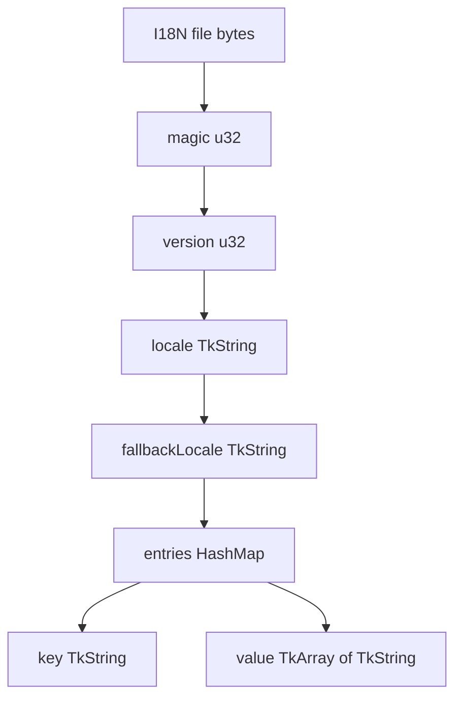

# I18n Binary Format (Manager + StringTable)

This document defines the binary format used by both:

- `toolkit::I18nStringTable`
- `toolkit::I18nManager` load path (`loadTableFromFile`, `loadTableFromStream`)

Both are now binary-only.

## 1) StringTable Binary (`.tla`)

Read/write is implemented through `corekit/io/Stream`:

- read: `ITkStream`
- write: `OTkStream`

### Header

- `u32 magic` = `0x4E383149` (`"I18N"` in little-endian byte order)
- `u32 version` = `1`

### Payload order

1. `TkString locale`
2. `TkString fallbackLocale`
3. `TkHashMap<TkString, TkArray<TkString>> entries`

### String encoding rule

`TkString` is serialized by Stream as:

1. `i32 length`
2. `length` bytes (UTF-8 bytes, no trailing `\0`)

### Collection encoding rule

- `TkArray<T>`: `i32 count` + serialized elements
- `TkHashMap<K,V>`: `i32 count` + repeated `(K,V)` pairs

### Plural text format

Plural strings use `sprintf`-style placeholders. Examples:

- `%d apple`
- `%d apples`

## 2) Data Graph



Byte-layout view:

```text
+------------------+------------------+
| magic (u32)      | version (u32)    |
+------------------+------------------+
| locale (TkString: i32 len + bytes)  |
+-------------------------------------+
| fallback (TkString)                 |
+-------------------------------------+
| entriesCount (i32)                  |
+-------------------------------------+
| entry[0].key (TkString)             |
| entry[0].valuesCount (i32)          |
| entry[0].value[0] (TkString)        |
| ...                                 |
+-------------------------------------+
| entry[n] ...                        |
+-------------------------------------+
```

## 3) Manager Integration Rules

- `I18nManager::loadTableFromFile(path)`:
  - opens `FileIStream`
  - calls `I18nStringTable::load(stream, &fallbackLocale)`
  - registers table into manager

- `I18nManager::loadTableFromStream(stream)`:
  - directly calls `I18nStringTable::load(...)`

- `fallbackTable` pointer is runtime-only and never serialized.
  Manager resolves it by `fallbackLocale` during `refreshLocalization()`.

## 4) Test Files

Location:

- `docs/testdata/i18n_en_v1.tla`
- `docs/testdata/i18n_en_gb_v1.tla`
- `docs/testdata/i18n_invalid_magic.tla`
- `docs/testdata/README.txt` (contains hex dump)

### Expected behavior

1. Load `i18n_en_v1.tla` should succeed.
2. Load `i18n_en_gb_v1.tla` should succeed.
3. After loading both, querying locale `en-GB` with missing key should fallback to `en`.
4. Load `i18n_invalid_magic.tla` should fail.
